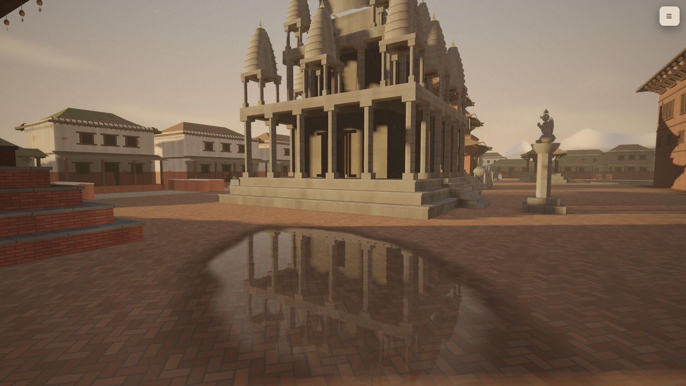
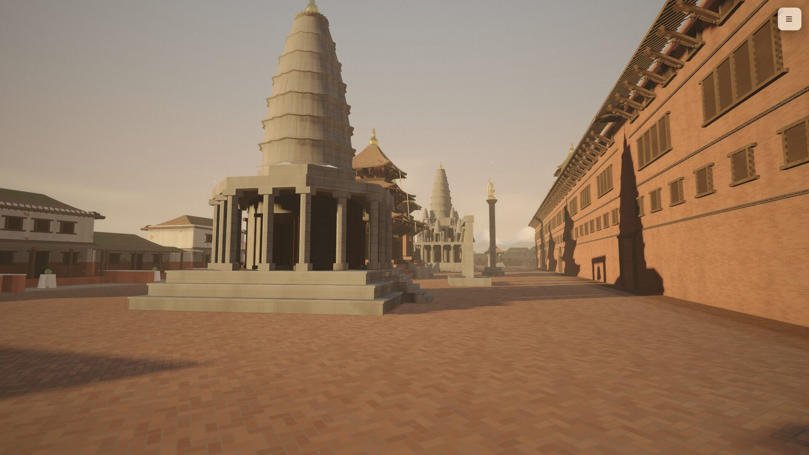
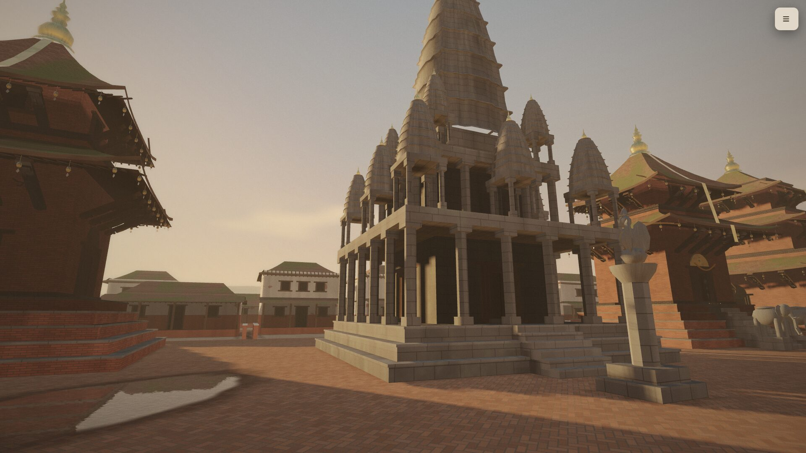
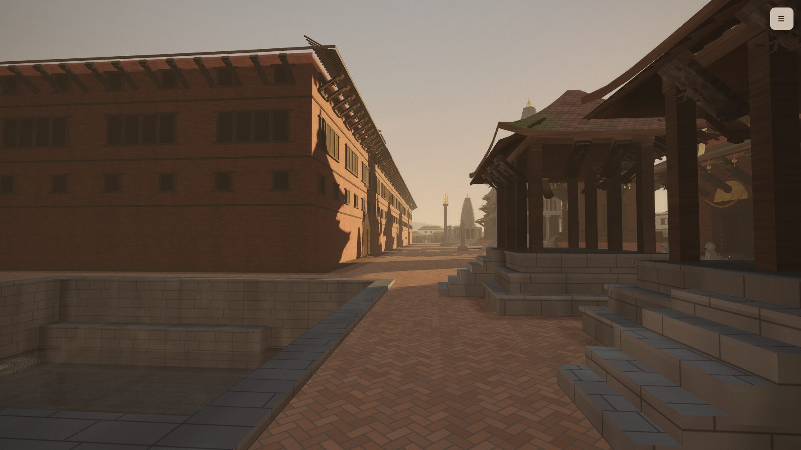
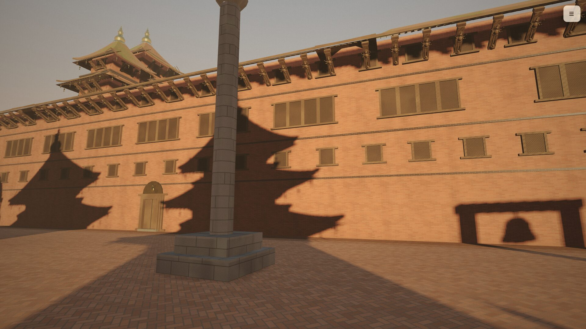
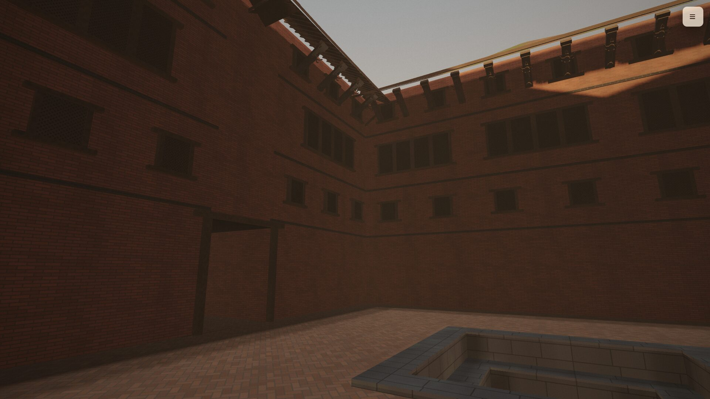

# Patan Durbar Square, 1985

**Walk through Patan's royal square on an afternoon in the mid-1980s, right in your browser.**

Pagoda temples with carved struts and tinkling eave bells, the stone shikhara of Krishna Mandir, the royal palace and its golden gate, Manga Hiti's stone spouts pouring into knee-deep water, a puddle from a passing shower mirroring the temples, and the snow peaks of the Himalaya catching the last golden light.
All of it is made by code: no images, no 3D models, no sound files. The whole square fits in **one ~100 KB HTML file**.



## Try it

**Play it online:** [patan-durbar-square-100kb.pages.dev](https://patan-durbar-square-100kb.pages.dev/) (also on [GitHub Pages](https://abhishekbasnet.github.io/patan-durbar-square-100kb/))

Or download it:

1. Download [`index.html`](index.html).
2. Open it in **Chrome** or **Edge** on a desktop computer (on a phone, in Chrome on Android).
3. Wait a few seconds while the square is built, then press **Enter the square** and start walking.

Nothing to install, and it works offline. It needs a browser with **WebGPU**. If you see *"This scene needs WebGPU"*, update your browser or switch to Chrome / Edge.

## What's there

- **The line of temples:** Bhimsen, Vishwanath with its stone elephants, Char Narayan, Hari Shankar, and the octagonal Krishna temple. Each has carved struts with many-armed deities, bells along every eave, gilded finials and the long gilded banner.
- **Krishna Mandir:** the stone shikhara with its colonnades and small kiosk towers, and Garuda kneeling on his pillar in front.
- **King Yoganarendra Malla** kneeling in gilded bronze on his tall pillar, under the cobra's hood.
- **The royal palace:** carved windows and struts along its front, the golden gate and golden window, Degutale and the Taleju tower rising above it, and Sundari Chowk's courtyard with the sunken Tusha Hiti bath.
- **Manga Hiti:** the sunken water spout. Three stone makara heads pour into knee-deep water, with rings spreading where the streams land.
- **Old mud houses** around the square: limewashed walls over red clay, the raised pidhi in front, and earthen aangan yards with tulsi plants.
- **Golden hour:** long temple shadows across the palace, sunbeams and drifting dust, incense smoke and butter lamps at the shrines, and a warm 1980s film look.
- **Sound, made up as you listen:** a slow wind, small eave bells chiming when you come near a temple, temple bells, the deep Taleju bell, and running water at Manga Hiti.

| | |
|---|---|
|  |  |
|  |  |



## Controls

| | Keyboard & mouse | Touch screen |
|---|---|---|
| Walk | `W` `A` `S` `D` | Joystick, bottom left |
| Look around | Move the mouse | Drag anywhere |
| Walk 30% faster | Hold `Shift` | **Fast** button |
| Hop | `Space` | **Hop** button |
| Viewpoints | `1` to `6` (the spots in the screenshots) | **View** button |
| Film look on / off | `V` | **Film** button |
| Sound on / off | `M` (sound starts with your first click or key) | **Sound** button |
| Menu | `Esc` | `≡` button |
| Performance stats | `H` | |

You can climb the temple plinths and walk down into Manga Hiti and Tusha Hiti. The temples are solid from the outside; there are no interiors.

## Detail levels

The **Low**, **Medium** and **High** buttons in the menu pick the detail level, and the current one is lit. Every level shows the same square:

| Level | What it is | Picked on a first visit for |
|---|---|---|
| **High** | Sharpest shadows and surfaces, more dust in the light | Dedicated graphics and the strongest integrated ones |
| **Medium** | The target: steady 60 fps at 1920x1080 on Intel Iris Xe | Most laptops |
| **Low** | 720p to start, no film look or water reflections, simpler shadows | Phones and older graphics |

Up close you see the carving in full: struts, bells, door frames. Further away it gives way to simpler shapes, cross-fading so nothing pops. If the frame rate drops, the resolution steps down a little at a time.

## How it works

- Every monument is built when the page opens, from a handful of reusable parts: plinths, brick cores, carved doorways, latticed windows, carved struts, pagoda roofs and shikhara towers. Each monument's file is mostly numbers.
- Bricks, paving, stone and roof tiles are painted into textures by code at load, so they stay crisp far away without shimmering.
- Everything is drawn with **WebGPU** directly. No game engine or 3D library is used.
- The sun never moves, so its shadows are drawn once at load and cost nothing per frame.
- The sound is synthesized live with the Web Audio API.
- See [REFERENCES.md](REFERENCES.md) for what each monument is based on, and [PERFORMANCE.md](PERFORMANCE.md) for measurements on Intel Iris Xe.

## Make it your own

The readable source code is in the [`source`](source) folder. To change something and rebuild `index.html` you need [Node.js](https://nodejs.org) 18 or newer:

```bash
cd source
npm install
npm run build          # ../index.html, minified, with a size report
npm run build:readable # ../index.html, unminified, for debugging
npm run build:dev      # ../dev.html, with F (scripted walk-through) and B (benchmark)
```

The build shortens every JS and WGSL name, so the readable names in the source cost nothing in the output. Hard limit: **150 KB** minified. Current size: **101.3 KB** minified, 37.9 KB gzipped.

### Source files

| File | What it does |
|---|---|
| `source/build.mjs` | Bundles to `../index.html`, minifies JS, minifies and renames WGSL, reports sizes |
| `source/template.html` | Page shell: loading bar, start menu, controls help |
| `src/main.js` | Entry point: builds the square, runs the frame loop and the menu |
| `src/dev.js` | Dev build only: scripted walk-through (F) and benchmark (B) |
| `src/core/math.js` | Scalars, seeded random, value noise, matrices |
| `src/core/meshBuilder.js` | Geometry helpers: transform stack, boxes, prisms, lathes, tubes, vertex packing |
| `src/core/renderer.js` | WebGPU device, render targets, pipelines, frame drawing, GPU timing |
| `src/core/camera.js` | Walking camera: eye height, head bob, hop, collision with steps and walls |
| `src/core/input.js` | Keyboard, mouse, and the on-screen touch controller (joystick, look drag, buttons) |
| `src/core/quality.js` | High / Medium / Low presets, the first-visit pick, automatic resolution scaling |
| `src/core/lod.js` | Distance levels of detail per chunk, view culling, dithered cross-fades |
| `src/architecture/plinths.js` | Stepped plinths with front stairs, and guardians placed beside them |
| `src/architecture/statues.js` | Lions, elephants, Garuda, King Yoganarendra under the cobra hood, makara spouts |
| `src/architecture/newarBuilding.js` | An ordinary Newar building: the palace wings |
| `src/architecture/mudHouse.js` | An old mud house: red clay and limewash, pidhi, aangan, tulsi pedestal |
| `src/architecture/brickWall.js` | Brick cores with glazed base bands and stepped cornices |
| `src/architecture/doorways.js` | Carved nested door frames, closed doors, toranas |
| `src/architecture/windows.js` | Latticed windows and window rows |
| `src/architecture/roofStruts.js` | Carved roof struts with deity figures |
| `src/architecture/pagodaRoof.js` | Tiered tile roofs, gilded finial, eave bells, the pataka banner |
| `src/architecture/pagodaTemple.js` | Assembles a whole pagoda temple from a table of numbers |
| `src/architecture/shikhara.js` | Stone shikhara towers, pillars, colonnades, kiosks |
| `src/monuments/*.js` | One file per monument, mostly numbers: Bhimsen, Vishwanath, Krishna Mandir, Char Narayan, Hari Shankar, the octagonal Krishna temple, the Garuda and King Yoganarendra pillars, the Taleju bell, Manga Hiti with the Mani Mandaps, the royal palace (three chowks, the golden gate, Tusha Hiti), Degutale and the Taleju tower |
| `src/monuments/allMonuments.js` | Places every monument from the layout, collects its collision and its sunken pits |
| `src/square/paving.js` | The ground, with the pits cut out |
| `src/square/water.js` | The puddle and Manga Hiti's pool and streams; the ripple event pool fed by the streams and footsteps |
| `src/square/layout.js` | The map: every monument's position, facing and size, and the 6 viewpoints |
| `src/square/blocks.js` | Solid blocks for collision, placed relative to a monument |
| `src/square/surroundings.js` | Two rows of mud houses beyond the square's invisible wall |
| `src/look/lighting.js` | The golden-hour sun, sky and haze; the shadow and sky occlusion map matrices |
| `src/look/surfaceTextures.js` | Paints brick, herringbone, stone-block and roof-tile patterns with mipmaps at load (no image files) |
| `src/look/materials.js` | Named materials: colour, roughness, metalness, weathering |
| `src/look/shaders/frameUniforms.wgsl.js` | Per-frame uniforms, haze, tone mapping |
| `src/look/shaders/lighting.wgsl.js` | Sun shadows, sky occlusion under eaves, bounce light, highlights |
| `src/look/shaders/surfaceTextures.wgsl.js` | Reads the painted patterns by distance and angle; large-scale weathering of walls |
| `src/look/shaders/brick, wood, stone, gold, tile .wgsl.js` | One file per material look |
| `src/look/shaders/architecture.wgsl.js` | Picks the material per vertex and lights it |
| `src/look/shaders/water.wgsl.js` | The puddle and Manga Hiti's water: outlines, Fresnel reflections, steady rings where the streams land, foam, footstep ripples, wind, the spout streams |
| `src/look/shaders/postProcess.wgsl.js` | The film look: warm faded 1980s colour, grain, vignette (V) |
| `src/look/shaders/sky.wgsl.js`, `noise.wgsl.js` | Sky, shared noise |
| `src/audio/ambientSounds.js` | Synthesized wind, bells and running water |
| `src/audio/soundscape.js` | The mix: gusts, eave bells heard only near their temple, temple and Taleju bells, Manga Hiti's water placed in space |

### Easy first tweaks

| What | Where |
|---|---|
| Sun angle | `sunAzimuthDegrees`, `sunElevationDegrees` in `src/look/lighting.js` |
| Sun colour | `goldenHourSunColor` in `src/look/lighting.js` |
| Walking speed | `walkingSpeedMetresPerSecond` in `src/core/camera.js` |
| Haze | `hazeDensityPerMetre` in `src/look/lighting.js` |
| Wind on the water | `windGustStrength` in `src/square/water.js` (0 for still water) |
| Detail switching distances | `lodSwitchDistances` in `src/core/lod.js` |
| Move or turn a monument | its row (`x`, `z`, `facingDegrees`) in `src/square/layout.js` |

| Film look strength | `filmLookStrength` in `src/look/shaders/postProcess.wgsl.js` (0 none, 1 full) |

## Credits

Built by [AbhishekBasnet](https://github.com/AbhishekBasnet) with Claude. It adapts parts of [Abyssal Garden](https://github.com/Noniv/abyssal-garden) (MIT). The reviews of the build are in [`reviews`](reviews). License: [MIT](LICENSE).
